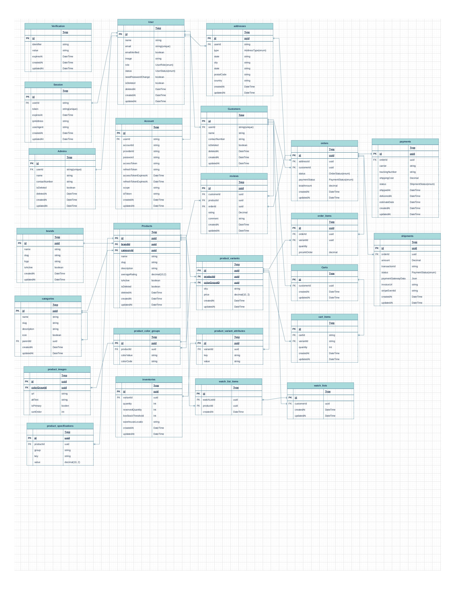

# E-Commerce Server (with Product Variants)

A backend API for an e-commerce platform built with **Node.js, Express, TypeScript, and Prisma (PostgreSQL)**. It supports product variants (color groups, attributes), inventory tracking, cart, orders, Stripe payments, shipments, reviews, and a watchlist — with role-based authentication powered by `better-auth`.

## Features

- **Product catalog** with brands, categories, and product variants (color groups, images, attributes, specifications)
- **Inventory management** with quantity, reserved quantity, and low-stock thresholds
- **Cart & checkout** with cart items tied to specific product variants
- **Order lifecycle** management (`PENDING → CONFIRMED → PROCESSING → PACKED → SHIPPED → DELIVERED`, plus `CANCELLED` / `RETURNED` / `REFUNDED`)
- **Payments** via Stripe, including webhook handling and refund/partial-refund statuses
- **Shipment tracking** per order (carrier, tracking number, delivery estimates)
- **Reviews** (one review per order/product per customer) and **watchlist** (wishlist)
- **Authentication & authorization** via `better-auth`, JWT access/refresh tokens, and Google OAuth
- **Role-based access control**: `SUPER_ADMIN`, `ADMIN`, `USER`, `CUSTOMER`
- **Image uploads** via Multer + Cloudinary
- **Email notifications** (OTP, order updates) via Nodemailer + EJS templates

## Tech Stack

| Category | Technology |
|---|---|
| Runtime | Node.js 20 |
| Language | TypeScript |
| Web framework | Express 5 |
| ORM / Database | Prisma 7 + PostgreSQL |
| Auth | better-auth, JSON Web Tokens, Google OAuth |
| Payments | Stripe |
| File storage | Cloudinary + Multer |
| Validation | Zod |
| Email | Nodemailer + EJS |
| Package manager | pnpm |
| Containerization | Docker |

## Project Structure

The codebase follows a modular structure — each feature under `src/app/modules/*` has its own `controller`, `service`, `route`, `validation`, and `interface` files (e.g. `product`, `order`, `payment`, `cart`, `review`, `inventory`, `customer`, `admin`, `auth`, `user`, `stats`).

See [docs/folder-structure.md](docs/folder-structure.md) for the full directory tree.

The Prisma schema is split by domain under [prisma/schema](prisma/schema):

- `address.prisma`, `admin.prisma`, `auth.prisma`, `brand.prisma`, `cart.prisma`, `category.prisma`, `customer.prisma`, `enums.prisma`, `order.prisma`, `payment.prisma`, `product.prisma`, `review.prisma`, `shipment.prisma`, `watchlist.prisma`

## Database Schema (ERD)



## Prerequisites

- Node.js 20+
- pnpm (version pinned in `package.json` → `packageManager`)
- PostgreSQL database
- Docker (optional, for containerized development)
- Stripe CLI (optional, for testing webhooks locally via `pnpm stripe:webhook`)

## Environment Variables

Copy `.env.example` to `.env` and fill in the values. Variables are validated at startup (see `src/app/config/env.ts`) and grouped as follows:

| Group | Variables |
|---|---|
| App | `NODE_ENV`, `PORT`, `FRONTEND_URL` |
| Database | `DATABASE_URL` |
| Better Auth | `BETTER_AUTH_SECRET`, `BETTER_AUTH_URL`, `BETTER_AUTH_SESSION_TOKEN_EXPIRES_IN`, `BETTER_AUTH_SESSION_TOKEN_UPDATE_AGE` |
| JWT | `ACCESS_TOKEN_SECRET`, `REFRESH_TOKEN_SECRET`, `ACCESS_TOKEN_EXPIRES_IN`, `REFRESH_TOKEN_EXPIRES_IN` |
| Email / SMTP | `EMAIL_SENDER_SMTP_USER`, `EMAIL_SENDER_SMTP_PASS`, `EMAIL_SENDER_SMTP_HOST`, `EMAIL_SENDER_SMTP_PORT`, `EMAIL_SENDER_SMTP_FROM` |
| Google OAuth | `GOOGLE_CLIENT_ID`, `GOOGLE_CLIENT_SECRET`, `GOOGLE_CALLBACK_URL` |
| Super Admin seed | `SUPER_ADMIN_EMAIL`, `SUPER_ADMIN_PASSWORD` |
| Cloudinary | `CLOUDINARY_CLOUD_NAME`, `CLOUDINARY_API_KEY`, `CLOUDINARY_API_SECRET` |
| Stripe | `STRIPE_SECRET_KEY`, `STRIPE_WEBHOOK_SECRET` |

## Getting Started

```bash
# 1. Clone the repository
git clone <repo-url>
cd e-com-server

# 2. Install dependencies
pnpm install

# 3. Set up environment variables
cp .env.example .env
# then fill in the required values

# 4. Generate the Prisma client
pnpm generate

# 5. Run database migrations
pnpm migrate

# 6. Start the development server
pnpm dev
```

The server runs on the port defined by `PORT` in your `.env` file (default: `5000`).

### Running with Docker

```bash
docker build -t e-com-server .
docker run --env-file .env -p 5000:5000 e-com-server
```

> The current `Dockerfile` targets a **development** image (runs `pnpm dev` with file watching). It is not yet optimized for production deployment.

## Available Scripts

| Script | Description |
|---|---|
| `pnpm dev` | Start the development server with hot reload (`tsx watch`) |
| `pnpm build` | Compile TypeScript to `dist/` |
| `pnpm start` | Run the compiled server from `dist/server.js` |
| `pnpm migrate` | Run Prisma migrations (`prisma migrate dev`) |
| `pnpm generate` | Generate the Prisma client |
| `pnpm studio` | Open Prisma Studio |
| `pnpm push` | Push the Prisma schema to the database without migrations |
| `pnpm pull` | Pull the database schema into Prisma |
| `pnpm lint` | Run ESLint across the `src` directory |
| `pnpm stripe:webhook` | Forward Stripe webhook events to `localhost:5000/webhook` (requires Stripe CLI) |

## API Documentation

A Postman collection is available at [docs/E-com API.postman_collection.json](docs/E-com%20API.postman_collection.json). Import it into Postman (**Import → File**) to explore and test all available endpoints.

## License

ISC — see `package.json` for details.

## Author

Saurav Barua
